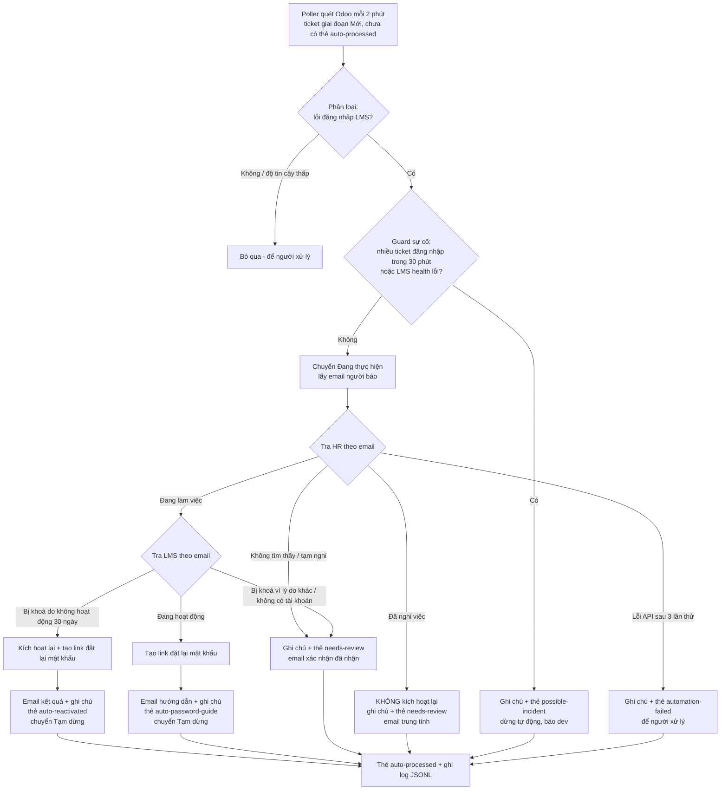

# Thiết kế workflow tự động hoá ticket đăng nhập

ticket **đăng nhập / tài khoản bị khoá** (Scenario 1, Week 4) – quy trình xử lý cố định 4 bước, nguyên nhân gốc nằm trong code (tài khoản tự vô hiệu hoá sau 30 ngày không đăng nhập), xử lý tay mất 5–10 phút mỗi ticket.

## 1. Mục tiêu và phạm vi

**Mục tiêu:** khi có ticket mới trên Odoo, workflow tự:
1. nhận diện ticket lỗi đăng nhập LMS,
2. kiểm tra trạng thái nhân sự trong hệ thống HR,
3. xử lý: còn làm việc → kích hoạt lại tài khoản LMS / gửi link đặt lại mật khẩu; đã nghỉ việc → ghi chú cho người xem xét,
4. gửi email phản hồi người dùng,
5. ghi log mọi quyết định và hành động.

**Trong phạm vi:** ticket của đội *MindX Tech Support*, hệ thống **LMS (Denise)**, người báo chính là chủ tài khoản.

**Ngoài phạm vi (chuyển người xử lý):** TMS, ECount, CRM, email công việc (chưa có API quản trị – mở rộng sau); yêu cầu thay người khác ("cấp lại mật khẩu cho giáo viên X"); cấp tài khoản mới.

## 2. Nguyên tắc thiết kế (theo slide Operating Engineer)

| Nguyên tắc | Áp dụng |
|---|---|
| **Non-invasive** | Không sửa code LMS. Workflow chỉ gọi API quản trị có sẵn (kích hoạt lại, tạo link đặt lại mật khẩu) – đúng thao tác support vẫn làm tay |
| **Automation-first** | Tự động phần lặp lại, cố định (kiểm tra HR, kích hoạt lại, phản hồi) |
| **Boundary-aware** | Chỉ tự hành động khi đủ điều kiện an toàn; mọi trường hợp còn lại chuyển người. Nhiều ticket đăng nhập cùng lúc = có thể là **sự cố hệ thống** → dừng tự động, báo dev (đúng ví dụ Login Issue trong slide) |
| **User-focused** | Phản hồi người dùng trong vài phút thay vì chờ tới lượt; email lịch sự, không thuật ngữ, không lộ thông tin nhân sự |
| **Không tự đóng ticket** | Sau khi xử lý, ticket chuyển **Tạm dừng** chờ người dùng xác nhận (góp ý mentor Week 4) |
| **Đo được** | Log từng quyết định để tính tỉ lệ tự động hoá và thời gian phản hồi (success metrics của Operating Engineer) |

### Vì sao tự động hoá thay vì sửa code

Nguyên nhân gốc là quy tắc **tự vô hiệu hoá tài khoản sau 30 ngày không đăng nhập** nằm trong code LMS.

| | Sửa code (Software Engineer) | Tự động hoá (Operating Engineer) – **đã chọn** |
|---|---|---|
| Làm gì | Đổi quy tắc khoá 30 ngày trong LMS | Workflow xử lý ticket bằng API quản trị có sẵn |
| Ai làm, bao lâu | Dev LMS; nhiều ngày–tuần, phải chờ ưu tiên trong backlog | Support / Operating Engineer; vài ngày, không chờ dev |
| Rủi ro | Đổi hành vi bảo mật cho mọi người dùng | Không đổi hệ thống; chỉ làm đúng thao tác support vẫn làm tay |
| Giải quyết | Nguyên nhân gốc, lâu dài | Triệu chứng, ngay lập tức |

Đối chiếu tiêu chí *When to Create Automation* (`tasks.md` Week 5):

| Tiêu chí | Ticket đăng nhập |
|---|---|
| Lặp lại thường xuyên | 14/121 ticket (11,6%); 18,2% nếu gộp nhóm truy cập tài khoản |
| Xử lý tay hiệu quả nhưng tốn thời gian | 4 bước cố định, 5–10 phút mỗi ticket |
| Sửa gốc cần đổi code | Quy tắc khoá 30 ngày trong LMS |
| Cần giải pháp ngay | Giáo viên cần tài liệu cho buổi dạy trong ngày |
| Xử lý được 80%+ trường hợp | D1/D2 hoàn tất tự động; D3–D6 phản hồi ngay và chuyển người kèm ghi chú đầy đủ |

**Khi nào chuyển sang sửa code** (đề xuất dev, xem [action-plan.md](action-plan.md) hành động #2): số ticket đăng nhập không giảm sau 8 tuần; ticket tự động bị mở lại trên 5%; nhiều hệ thống (TMS, ECount) có cùng quy tắc khoá. Đề xuất sửa gốc: gửi email cảnh báo 7 ngày trước khi khoá, hoặc không khoá tài khoản giáo viên đang được xếp lớp.

## 3. Luồng xử lý



## 4. Bảng quyết định

| # | Điều kiện | Workflow tự làm | Email người dùng | Odoo |
|---|---|---|---|---|
| D1 | Lỗi đăng nhập LMS, HR **đang làm việc**, LMS **bị khoá do không hoạt động** | Kích hoạt lại + tạo link đặt lại mật khẩu | Đã kích hoạt lại, nhờ đặt mật khẩu và xác nhận | Ghi chú, thẻ `auto-reactivated`, giai đoạn **Tạm dừng** |
| D2 | HR **đang làm việc**, LMS **đang hoạt động** | Tạo link đặt lại mật khẩu | Hướng dẫn đặt lại mật khẩu, nhờ xác nhận | Ghi chú, thẻ `auto-password-guide`, **Tạm dừng** |
| D3 | HR **đã nghỉ việc** | **Không** kích hoạt lại | Trung tính: đã nhận, cần kiểm tra thêm theo quy trình, không nêu thông tin nhân sự | Ghi chú (kèm trạng thái HR) cho người xem xét, thẻ `needs-review`, giữ **Đang thực hiện** |
| D4 | HR **không tìm thấy** / **tạm nghỉ**; LMS bị khoá vì lý do khác (admin khoá, bảo mật) hoặc không có tài khoản; người báo yêu cầu thay người khác | Không làm gì | Xác nhận đã nhận, sẽ phản hồi trong 30 phút | Ghi chú lý do, thẻ `needs-review` |
| D5 | HR/LMS API lỗi sau 3 lần thử | Dừng | Không gửi (tránh hứa khi chưa có kết quả) | Ghi chú lỗi, thẻ `automation-failed`, giữ **Mới** để người xử lý trong SLA |
| D6 | ≥ 5 ticket đăng nhập trong 30 phút, hoặc LMS health check lỗi | Dừng tự động cho cả loạt | Không gửi kết quả | Ghi chú "có thể là sự cố hệ thống", thẻ `possible-incident` – xử lý theo quy trình Priority/Expedite |
| D7 | Không phải lỗi đăng nhập LMS / độ tin cậy thấp | Bỏ qua | – | Không thay đổi (không gắn thẻ) |

## 5. Phân loại ticket (classifier)


| Thành phần | Ví dụ |
|---|---|
| Từ khoá lỗi đăng nhập | `dang nhap`, `mat khau`, `khong vao duoc`, `khong truy cap`, `bi khoa`, `invalid username or password`, `login`, `password` |
| Hệ thống đích = LMS | `lms`, `denise` (không có tên hệ thống → mặc định LMS vì 9/12 ticket Week 4 là LMS, nhưng hạ độ tin cậy) |
| Loại trừ | `cap tai khoan`, `tao tai khoan`, `chuyen tai khoan` (cấp mới/chuyển); `tms`, `ecount`, `crm`, `mail` (hệ thống ngoài phạm vi); `cho giao vien`, `cho hoc vien`, `cho ban` (yêu cầu thay người khác); `nhieu`, `ca lop`, `tat ca` (nhiều người bị ảnh hưởng → không phải Standard) |

Kết quả: `is_login_issue`, `confidence` (`high` khi khớp ở cả tiêu đề và mô tả hoặc có tên LMS; `low` khi chỉ khớp một từ chung), `system`, `matched_keywords`, `exclusion`. Chỉ `high` mới đi tiếp.

## 6. Kiến trúc (Hexagonal – theo slide Hexagonal Architecture)

Workflow tích hợp 3 hệ thống bên ngoài (Odoo, HR, LMS) và cần test kỹ trước khi chạy thật – đúng trường hợp "multiple integrations" mà slide khuyên dùng kiến trúc lục giác. Lõi nghiệp vụ không biết gì về HTTP hay Odoo; test lõi bằng adapter giả.

```
automation/
├── domain/                       # Lõi: Python thuần, không I/O
│   ├── models.py                 # Ticket, Employee, LmsAccount, Classification, Decision
│   ├── classifier.py             # nhận diện ticket lỗi đăng nhập
│   ├── decision.py               # bảng quyết định D1–D7 (hàm thuần)
│   └── messages.py               # mẫu email + ghi chú
├── application/
│   └── process_ticket.py         # điều phối: gọi port theo quyết định, xử lý lỗi, idempotent
├── ports.py                      # interface: TicketGateway, HrDirectory, LmsAdmin, AuditLog
├── adapters/
│   ├── odoo_json2.py             # TicketGateway qua Odoo External JSON-2 API
│   ├── hr_http.py, lms_http.py   # gọi HR/LMS API (timeout, retry)
│   ├── jsonl_audit_log.py        # log JSON Lines, che email
│   └── fakes.py                  # adapter giả cho test
└── entrypoints/
    ├── poller.py                 # trigger chính: quét định kỳ (--once, --dry-run, --interval)
    └── webhook_server.py         # trigger mở rộng khi cài module Quy tắc tự động hoá
mock_services/                    # FastAPI giả lập HR và LMS (quy tắc khoá 30 ngày)
tests/                            # unit (domain), service (fakes), integration (mock services)
```

| Port | Phương thức | Adapter thật |
|---|---|---|
| `TicketGateway` | `fetch_new_tickets()`, `move_stage()`, `add_tags()`, `post_note()`, `send_email()`, `count_recent_login_tickets()` | Odoo JSON-2: `helpdesk.ticket/search_read`, `write`, `message_post` |
| `HrDirectory` | `find_employee(email)` → `active` / `terminated` / `on_leave` / không có | HR API (mock) |
| `LmsAdmin` | `get_account(email)`, `reactivate(email)`, `create_reset_link(email)`, `health()` | LMS API (mock) |
| `AuditLog` | `record(event)` | file `logs/automation.jsonl` |

## 7. Tích hợp Odoo

| Việc | API (External JSON-2, đã kiểm chứng kết nối ở Giai đoạn 0) |
|---|---|
| Lấy ticket mới | `POST /json/2/helpdesk.ticket/search_read` – domain: đội MindX Tech Support, giai đoạn *Mới*, không có thẻ `auto-processed` |
| Đổi giai đoạn, gắn thẻ | `POST /json/2/helpdesk.ticket/write` (`stage_id`, `tag_ids` dạng lệnh thêm) |
| Ghi chú nội bộ | `POST /json/2/helpdesk.ticket/message_post` với subtype ghi chú |
| Email cho khách hàng | `message_post` với subtype bình luận gửi tới người báo |

**Cần kiểm chứng ở đầu Giai đoạn 4** (theo nguyên tắc "verify, không đoán" của slide AI Training): tham số chính xác của `message_post` (subtype `mail.mt_note` / `mail.mt_comment`, `partner_ids`) qua JSON-2 trên Odoo 20, và cách ghi `tag_ids`. Viết một script thử trên 1 ticket test trước khi code adapter.

**Trigger:** quét định kỳ mỗi 2 phút (đã quyết định ở Giai đoạn 0 – module Quy tắc tự động hoá chưa cài). Chạy bằng `python -m automation.entrypoints.poller` hoặc Windows Task Scheduler. `webhook_server.py` dùng chung `process_ticket`, bật được khi có webhook.

**Thẻ cần tạo trên Odoo:** `auto-processed`, `auto-reactivated`, `auto-password-guide`, `needs-review`, `automation-failed`, `possible-incident`.

**SLA:** ticket đăng nhập là Standard (ưu tiên 1 sao, phản hồi 30 phút). Workflow chuyển *Đang thực hiện* ngay khi xử lý → đạt SLA trong vài phút.

## 8. Mẫu email (giọng lịch sự, theo góp ý mentor Week 4)

Biến: `{name}` tên người báo, `{ref}` số ticket, `{link}` link đặt lại mật khẩu (hết hạn sau 24 giờ). Mọi email ký tên *MindX Tech Support* và ghi rõ là phản hồi tự động.

**D1 – Đã kích hoạt lại**
```
Chào anh/chị {name},

Cảm ơn anh/chị đã liên hệ. Team đã kiểm tra và kích hoạt lại tài khoản LMS của anh/chị (ticket #{ref}); tài khoản bị tạm khoá do chưa đăng nhập trong 30 ngày.

Nhờ anh/chị đặt lại mật khẩu qua đường dẫn sau (hiệu lực 24 giờ): {link}
Sau khi đăng nhập được, nhờ anh/chị phản hồi email này giúp team. Nếu vẫn gặp lỗi, team sẽ hỗ trợ ngay.

Trân trọng,
MindX Tech Support (phản hồi tự động)
Ticket #{ref}
```

**D2 – Hướng dẫn đặt lại mật khẩu**
```
Chào anh/chị {name},

Cảm ơn anh/chị đã liên hệ. Team đã kiểm tra, tài khoản LMS của anh/chị vẫn hoạt động bình thường (ticket #{ref}); lỗi nhiều khả năng do mật khẩu nhập chưa khớp.

Nhờ anh/chị đặt lại mật khẩu qua đường dẫn sau (hiệu lực 24 giờ): {link}
Sau khi đăng nhập được, nhờ anh/chị phản hồi email này giúp team. Nếu vẫn gặp lỗi, team sẽ hỗ trợ ngay.

Trân trọng,
MindX Tech Support (phản hồi tự động)
Ticket #{ref}
```

**D3 – Cần kiểm tra thêm (đã nghỉ việc – không nêu lý do)**
```
Chào anh/chị {name},

Cảm ơn anh/chị đã liên hệ. Team đã nhận yêu cầu về tài khoản LMS (ticket #{ref}); tài khoản này cần được kiểm tra thêm theo quy trình.

Team sẽ phản hồi anh/chị trong vòng 1 ngày làm việc. Nếu cần gấp, nhờ anh/chị liên hệ quản lý trực tiếp giúp team.

Trân trọng,
MindX Tech Support (phản hồi tự động)
Ticket #{ref}
```

**D4 – Xác nhận đã nhận**
```
Chào anh/chị {name},

Cảm ơn anh/chị đã liên hệ. Team đã nhận thông tin anh/chị chưa đăng nhập được LMS (ticket #{ref}) và đang kiểm tra.

Team sẽ phản hồi anh/chị trong vòng 30 phút (giờ làm việc). Trong lúc chờ, nhờ anh/chị thử đăng nhập bằng cửa sổ ẩn danh giúp team.

Trân trọng,
MindX Tech Support (phản hồi tự động)
Ticket #{ref}
```

## 9. An toàn và độ tin cậy

| Rủi ro | Biện pháp |
|---|---|
| Xử lý một ticket hai lần | Thẻ `auto-processed` + kiểm tra log trước khi xử lý; mọi thao tác ghi Odoo làm cuối cùng |
| Kích hoạt nhầm tài khoản | Chỉ khi email người báo = email HR = email LMS; độ tin cậy `high`; lý do khoá = không hoạt động |
| Mở lại tài khoản người đã nghỉ | HR là nguồn quyết định; `terminated` không bao giờ kích hoạt lại |
| Sự cố hệ thống bị xử lý như lỗi cá nhân | Guard D6: ngưỡng số ticket + LMS health check |
| API lỗi giữa chừng | Timeout 10 giây, thử lại 3 lần (chờ 1–2–4 giây); thất bại → D5, không gửi email hứa hẹn |
| Lộ dữ liệu | API key trong `.env`; log che email (`ng***@example.com`); không ghi mật khẩu, link đặt lại chỉ gửi người dùng |
| Chạy thử an toàn | `--dry-run`: đọc ticket, tính quyết định, ghi log, **không** ghi gì lên Odoo/HR/LMS |

## 10. Đo lường (trước / sau)

| Chỉ số | Trước (thủ công) | Mục tiêu |
|---|---|---|
| Thời gian phản hồi đầu tiên ticket đăng nhập | đến 30 phút (SLA), thực tế Week 4: 10–16 phút, có ca 23 giờ | ≤ 2 phút (chu kỳ quét) |
| Thời gian thao tác của support mỗi ticket | 5–10 phút | 0 phút với D1/D2; chỉ xem ghi chú với D3–D6 |
| Tỉ lệ tự động hoá (D1+D2 / tổng ticket đăng nhập LMS) | 0% | ≥ 70% |
| Ticket tự động bị mở lại / phản hồi "vẫn lỗi" | – | < 5% |

Số liệu lấy từ `logs/automation.jsonl` và báo cáo Odoo lọc theo thẻ `auto-*`.

## 11. Chiến lược kiểm thử (TDD)

| Mức | Nội dung |
|---|---|
| Unit – domain | Classifier với tiêu đề thật từ `sample.xlsx` (14 ticket đăng nhập, các ticket loại trừ); bảng quyết định đủ D1–D7 và các biên (email lệch, lý do khoá khác) |
| Service | `process_ticket` với adapter giả: đúng chuỗi hành động từng nhánh, idempotent, retry rồi D5, guard D6 |
| Integration | Adapter HR/LMS gọi `mock_services` thật; adapter Odoo kiểm tra request/response JSON-2 |
| End-to-end | 7 ca trên Odoo thật (Giai đoạn 5): D1, D2, D3, D4, ticket không liên quan, tắt mock HR, chạy lại không xử lý trùng |

