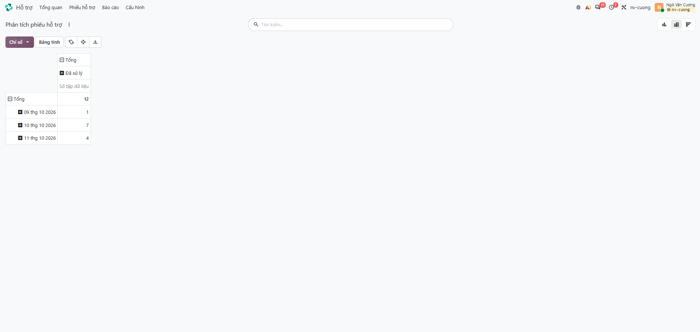
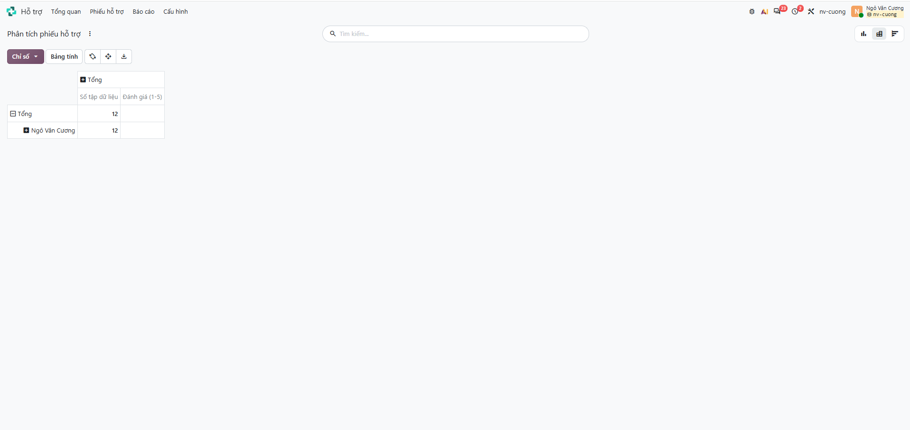
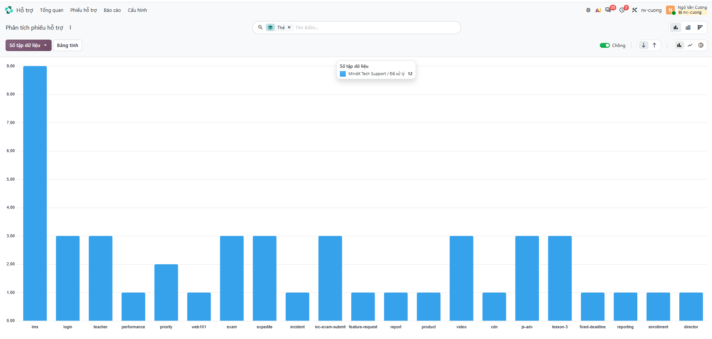
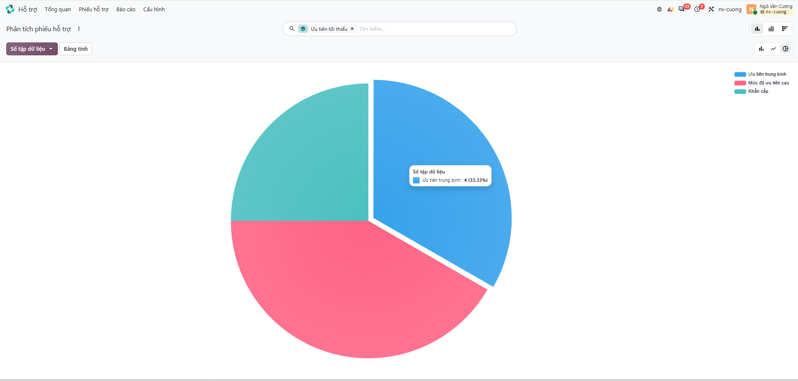
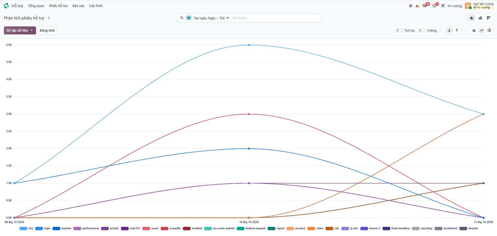
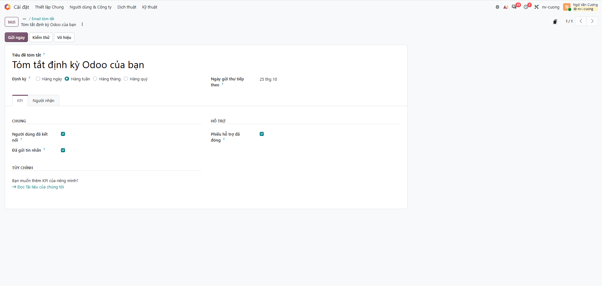
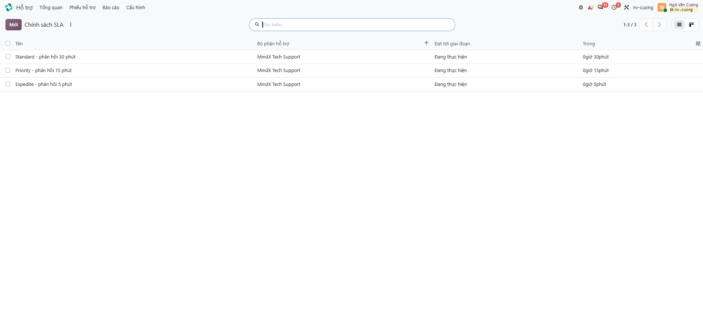

# Báo cáo trên Odoo Helpdesk

Giai đoạn 1 của Week 5: dùng công cụ báo cáo có sẵn của Odoo 20 (`nv-cuong.odoo.com`, đội **MindX Tech Support**) để xem số liệu ticket. Dữ liệu là 12 ticket thực hành của Week 4 (tạo 09–11/10/2026).

Tất cả báo cáo mở từ **Hỗ trợ → Báo cáo → Phân tích phiếu hỗ trợ**, đổi dạng xem (Pivot / Biểu đồ) ở góc trên bên phải, đổi số liệu bằng nút **Chỉ số / Số tập dữ liệu** và đổi cách nhóm bằng **Tìm kiếm → ▾ → Nhóm theo**. Mỗi báo cáo được lưu lại bằng **Yêu thích → Lưu tìm kiếm hiện tại** để dùng lại.

## 1. Tổng hợp ticket theo ngày

- **Mục đích:** xem mỗi ngày nhận bao nhiêu ticket và đang ở giai đoạn nào.
- **Cách tạo:** Pivot; dòng = *Được tạo vào → Ngày*; cột = *Giai đoạn*; chỉ số = *Số lượng*. Export: nút tải xuống → [`analysis/output/report-daily.xlsx`](../analysis/output/report-daily.xlsx).

**Nhận xét:** 12 ticket trong 3 ngày (09/10: 1, 10/10: 7, 11/10: 4), tất cả đã ở giai đoạn *Đã xử lý*, không còn ticket tồn.

## 2. Hiệu suất team

- **Mục đích:** số ticket mỗi người xử lý, thời gian phản hồi/đóng, mức hài lòng.
- **Cách tạo:** Pivot; dòng = *Phân công cho*; chỉ số = *Số lượng*, *Đánh giá (1–5)*, *Số giờ tới lần phản hồi đầu tiên*, *Giờ làm việc để đóng*.

**Nhận xét:**
- 1 người xử lý toàn bộ 12 ticket (môi trường thực hành một người).
- Cột **Đánh giá** trống: khách hàng là địa chỉ `@example.com` giả lập nên không có ai trả lời khảo sát.
- Các chỉ số tính theo **giờ làm việc** (thời gian phản hồi, thời gian đóng) trống vì ticket được xử lý buổi tối và cuối tuần (10–11/10 là thứ Bảy, Chủ nhật), ngoài lịch làm việc của đội. Thời gian thực tế được tính lại từ *Ngày đóng − Được tạo vào* ở phần phân tích ([pattern-analysis.md](pattern-analysis.md)).

## 3. Phân tích theo loại

- **Mục đích:** nhóm vấn đề nào chiếm nhiều ticket nhất.
- **Cách tạo:** Biểu đồ cột; nhóm theo *Thẻ* (một ticket có nhiều thẻ được đếm ở mỗi thẻ).

**Theo mức độ ưu tiên** (biểu đồ tròn, nhóm theo *Mức độ ưu tiên*):

**Nhận xét:**
- `lms` xuất hiện ở 9/12 ticket: phần lớn yêu cầu liên quan tới hệ thống LMS.
- Ưu tiên: Trung bình (1 sao, Standard) 4 · Cao (2 sao, Priority/Fixed Deadline) 5 · Khẩn cấp (3 sao, Expedite) 3.
- **Thẻ đang trộn nhiều chiều**: hệ thống (`lms`, `cdn`), loại vấn đề (`login`, `video`, `performance`), mức ưu tiên (`priority`, `expedite`), sự cố cụ thể (`inc-exam-submit`, `lesson-3`). Nên tách thành nhóm thẻ có quy ước (xem [action-plan.md](action-plan.md)) để báo cáo theo loại chính xác hơn.

## 4. Xu hướng số lượng ticket

- **Mục đích:** số ticket theo thời gian, tách theo loại.
- **Cách tạo:** Biểu đồ đường; nhóm theo *Được tạo vào → Ngày*, nhóm phụ *Thẻ*; tắt *Chồng* để mỗi đường là số thật.

**Nhận xét:** đỉnh ngày 10/10 (7 ticket, trong đó 5 ticket `lms`). Với 3 ngày dữ liệu, biểu đồ chỉ minh hoạ cách làm; xu hướng thật cần nhiều tuần – phần phân tích dùng thêm bộ dữ liệu 131 ticket (`sample.xlsx`).

## 5. Lên lịch gửi báo cáo

**Cài đặt → Email tóm tắt** (bật) → *Tóm tắt định kỳ Odoo của bạn*: định kỳ **Hằng tuần**, KPI gồm *Người dùng đã kết nối*, *Đã gửi tin nhắn* và **Hỗ trợ → Phiếu hỗ trợ đã đóng**; lần gửi tiếp theo 25/10. Nút **Gửi ngay** dùng để gửi thử.

## 6. Cấu hình SLA theo Class of Service

Báo cáo *Phân tích trạng thái SLA* ban đầu không có dữ liệu vì đội chưa có chính sách SLA. Đã tạo 3 chính sách (giai đoạn đích **Đang thực hiện** = thời gian phản hồi), áp dụng cho ticket tạo từ nay:

| Chính sách | Điều kiện | Thời hạn |
|---|---|---|
| Standard – phản hồi 30 phút | Mức độ ưu tiên = Trung bình (1 sao) | 30 phút |
| Priority – phản hồi 15 phút | Mức độ ưu tiên = Cao (2 sao) | 15 phút |
| Expedite – phản hồi 5 phút | Mức độ ưu tiên = Khẩn cấp (3 sao) | 5 phút |

## Tóm tắt phát hiện

| # | Phát hiện | Ảnh hưởng | Đề xuất |
|---|---|---|---|
| 1 | LMS chiếm 9/12 ticket | Tập trung cải thiện/tự động hoá cho LMS | Tự động hoá ticket đăng nhập LMS (Giai đoạn 4) |
| 2 | Thẻ trộn nhiều chiều, không có quy ước | Báo cáo theo loại thiếu chính xác | Bộ thẻ chuẩn: `sys:`, `issue:`, `inc:`; ưu tiên dùng trường Mức độ ưu tiên |
| 3 | Chưa có dữ liệu đánh giá khách hàng | Không đo được mức hài lòng | Bật khảo sát, theo dõi tỉ lệ phản hồi |
| 4 | SLA chưa cấu hình trước đây; chỉ số giờ làm việc trống khi xử lý ngoài giờ | Không đo được tuân thủ thời gian phản hồi | Đã tạo 3 chính sách SLA; báo cáo SLA hằng tuần |
