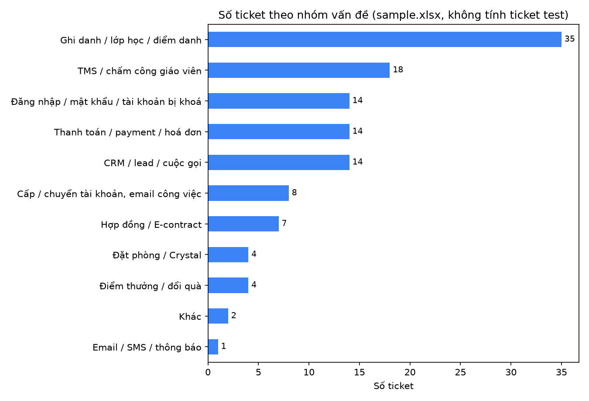

# Phân tích mẫu ticket lặp lại

Giai đoạn 2 của Week 5: tìm vấn đề lặp lại, chọn **top 3** để phân tích sâu, đề xuất phương án và chọn vấn đề tự động hoá. Kế hoạch triển khai chi tiết: [action-plan.md](action-plan.md).

## 1. Dữ liệu và phương pháp

| Nguồn | Nội dung | Ghi chú |
|---|---|---|
| `sample.xlsx` (thư mục `week-5/data` của onboarding, **không commit** vì có tên thật) | 131 ticket Helpdesk thật, đội Technical Support | Có tiêu đề, thẻ, ưu tiên, giai đoạn, người báo; **không có cột ngày giờ, không có mô tả** |
| `data/raw/week4-tickets.xlsx` (export Odoo, không commit) | 12 ticket thực hành Week 4 | Có ngày tạo, ngày đóng |
| `tests/fixtures/sample_anonymized.xlsx` (commit) | 18 ticket **tự tạo, ẩn danh**, cùng định dạng | Để chạy lại script khi không có dữ liệu gốc |

Script [`analysis/analyze_tickets.py`](../analysis/analyze_tickets.py): đọc file export dạng nhóm của Odoo → ẩn danh người báo (`User-001`…), **không ghi tiêu đề ra file** → phân nhóm bằng từ khoá tiếng Việt không dấu (tiêu đề trước, thẻ sau, vì 49% ticket không có thẻ) → tính số ticket, %, số người báo, ticket Urgent/High, ticket thiếu thẻ.

```powershell
python analysis/analyze_tickets.py --sample <đường dẫn sample.xlsx>          # dữ liệu thật
python analysis/analyze_tickets.py --sample tests/fixtures/sample_anonymized.xlsx   # dữ liệu mẫu
```
Phân nhóm tái hiện được: `tests/test_analysis.py` kiểm tra số ticket từng nhóm trên dữ liệu mẫu; chạy lại trên `sample.xlsx` cho đúng bảng ở mục 2.

**Quy ước số liệu:** *Đo được* = đếm trực tiếp từ dữ liệu trên. *Ước tính* = có giả định, ghi rõ giả định. `sample.xlsx` không có thời gian, nên **không có số đo thời gian xử lý** cho 131 ticket; thời gian đo được chỉ có ở 12 ticket Week 4.

## 2. Tổng quan (đo được)

131 ticket, 10 ticket test bị loại → **121 ticket**, 78 người báo. Ưu tiên: Urgent 40 · High 42 · Medium 9 · Low 40 (63% Urgent/High). 64/131 ticket (49%) không có thẻ.



| Nhóm | Ticket | % | Người báo | Urgent/High | Không thẻ |
|---|---|---|---|---|---|
| Ghi danh / lớp học / điểm danh | 35 | 28,9% | 24 | 25 | 16 |
| TMS / chấm công giáo viên | 18 | 14,9% | 16 | 15 | 7 |
| CRM / lead / cuộc gọi | 14 | 11,6% | 11 | 11 | 6 |
| Thanh toán / payment | 14 | 11,6% | 10 | 10 | 7 |
| Đăng nhập / mật khẩu / tài khoản bị khoá | 14 | 11,6% | 8 | 6 | 10 |
| Các nhóm còn lại (cấp tài khoản 8, hợp đồng 7, điểm thưởng 4, đặt phòng 4, khác 2, email 1) | 26 | 21,5% | – | – | – |

## 3. Chọn top 3

Hai nhóm đầu rõ ràng: **Ghi danh (35)** và **TMS (18)**. Vị trí thứ 3 có **ba nhóm đồng hạng 14 ticket**: CRM, Thanh toán, Đăng nhập. Tiêu chí phân xử:

| Tiêu chí | CRM | Thanh toán | Đăng nhập |
|---|---|---|---|
| Người báo khác nhau (đo được) | **11** | 10 | 8 |
| Ticket Urgent/High (đo được) | **11** | 10 | 6 |
| Ticket không thẻ – nguy cơ bị đếm thiếu (đo được) | 6/14 (43%) | 7/14 (50%) | **10/14 (71%)** |
| Support tự xử lý được không cần bộ phận khác | Một phần (cần Product CRM) | Không (cần kế toán duyệt) | **Có** (thao tác tài khoản cố định) |
| Có thể mở rộng thành nhóm lớn hơn | – | – | **Truy cập tài khoản: 14 + 8 cấp tài khoản = 22 (18,2%)** |
| Yêu cầu Week 5 | – | – | **Scenario 1 – Login Issue** |

**Chọn Đăng nhập làm nhóm thứ 3.** Xét riêng tác động (số người, mức khẩn) thì CRM xếp trên; Đăng nhập được chọn vì (1) support xử lý trọn vẹn được mà không phụ thuộc bộ phận khác, (2) có dấu hiệu bị đếm thiếu mạnh nhất (71% không thẻ), (3) là bài toán tự động hoá được yêu cầu trong Week 5. CRM là ứng viên kế tiếp (5/14 ticket là chuyển trạng thái lead – có quy tắc, xem action plan mục F1); Thanh toán phụ thuộc kế toán nên để backlog.

## 4. Phân tích top 3

### 4.1. Ghi danh / lớp học / điểm danh – 35 ticket (28,9%)

**Vấn đề – triệu chứng (đo được, theo từ khoá tiêu đề):**

| Triệu chứng | Ticket |
|---|---|
| Không enroll được / thêm học viên vào lớp / mở slot, học phần | 18 |
| Thông tin học viên/lớp sai (tên, trạng thái, giờ học, Compass) | 6 |
| Không tạo được phiếu dropout | 4 |
| Không điểm danh được | 2 |
| Không thêm/tìm được giáo viên, lớp | 1 |
| Khác (chỉ ghi mã lớp) | 4 |

**Bằng chứng khác:** 25/35 Urgent/High; 10/35 vẫn ở *First Response Sent* (chưa xong) – nhiều nhất trong các nhóm; 24 người báo khác nhau (lỗi phân tán ở nhiều cơ sở, không phải một sự cố).

**Vì sao xảy ra – nguyên nhân khả dĩ (giả thuyết, chưa xác minh):**
1. BU không có quyền tự enroll / mở slot, phải nhờ Tech.
2. Dữ liệu CRM (lead/order) chưa đồng bộ sang LMS nên không enroll được.
3. Ticket thiếu thông tin (mã lớp, mã học viên) → phải hỏi lại, kéo dài thời gian.

**Nguyên nhân gốc đã xác minh:** chưa có. Cần dữ liệu nguyên nhân từng ticket (action B3).

**Phương án:**

| Phương án | Công sức | Tác động (ước tính) | Thời gian | Phụ thuộc | Rủi ro |
|---|---|---|---|---|---|
| A. KB tự phục vụ + mẫu yêu cầu chuẩn (bắt buộc mã lớp, mã HV, trạng thái lead) | Thấp | Giảm ticket "không biết cách" và ticket thiếu thông tin | 2 tuần | Không | Không giảm ticket do lỗi đồng bộ |
| B. Cấp quyền enroll cho BU có kiểm soát | Trung bình | Giảm phần lớn ticket "nhờ enroll" nếu giả thuyết 1 đúng | 4–6 tuần | Product LMS duyệt quyền | Enroll sai lớp, khó kiểm soát |
| C. Script enroll tự động từ yêu cầu chuẩn (Odoo → LMS API) | Trung bình–cao | Tự xử lý ticket enroll đủ thông tin | 6–8 tuần | API enroll của LMS, dữ liệu chuẩn từ A | Sai dữ liệu nhân rộng |

**Chọn A trước**, đồng thời gắn thẻ nguyên nhân 2 tuần để quyết định B hay C dựa trên số liệu (không chọn B/C khi chưa biết giả thuyết nào đúng).

**Xử lý và escalate:**
1. Support kiểm tra ticket đủ thông tin (mã lớp, mã HV, lead/order); thiếu → phản hồi xin bổ sung kèm link KB, ticket *Tạm dừng*.
2. Lead/order chưa sang LMS → gắn thẻ nguyên nhân `cause:sync`, escalate Dev CRM kèm mã lead/order.
3. Thao tác được bằng quyền admin (enroll, mở slot) → support làm, phản hồi, gắn thẻ `cause:permission`.
4. ≥ 3 cơ sở cùng không enroll được trong 1 giờ → xử lý như sự cố (Priority), báo Dev LMS.

### 4.2. TMS / chấm công giáo viên – 18 ticket (14,9%)

**Vấn đề – triệu chứng (đo được):**

| Triệu chứng | Ticket |
|---|---|
| TMS không hiển thị công / thông tin | 7 |
| Chấm công sai (đi đúng ca bị báo trễ, lỗi phần mềm chấm công) | 4 |
| Không tạo / duyệt được bù công | 3 |
| Mất dữ liệu / lỗi chung, "nhờ check TMS" | 3 |
| Khác | 1 |

**Bằng chứng khác:** 16 người báo khác nhau; 10/18 Urgent (cao nhất tỉ lệ); có tiêu đề nêu "lỗi từ ngày 31", "trước khi hết tháng" → dấu hiệu dồn vào thời điểm chốt công.

**Nguyên nhân khả dĩ (giả thuyết):**
1. Đồng bộ dữ liệu điểm danh → TMS lỗi theo đợt.
2. Tải cao / lỗi xử lý vào cuối tháng khi chốt công.
3. Quyền duyệt công cấu hình sai cho một số BU.

**Nguyên nhân gốc đã xác minh:** chưa có. Support không có quyền vào log TMS; cần dev TMS kiểm tra.

**Phương án:**

| Phương án | Công sức | Tác động (ước tính) | Thời gian | Phụ thuộc | Rủi ro |
|---|---|---|---|---|---|
| A. Gom 18 ticket thành một báo cáo lỗi có bằng chứng gửi dev TMS | Thấp | Là điều kiện để sửa gốc; tự nó chưa giảm ticket | 1 tuần | Dev TMS tiếp nhận | Dev chưa ưu tiên |
| B. Runbook + quy tắc nhận diện sự cố (nhiều BU cùng triệu chứng) | Thấp | Gom ticket trùng, phản hồi nhanh, escalate sớm | 1–2 tuần | Không | Không giảm số lỗi |
| C. Cảnh báo tự động khi đồng bộ công lỗi | Trung bình | Phát hiện trước khi BU báo | 4–6 tuần | DevOps, quyền đọc log/metric TMS | Cảnh báo giả |

**Chọn A + B:** lỗi nằm trong hệ thống (ngoài phạm vi Operating Engineer sửa), nên việc đúng là escalate có bằng chứng (A) và chuẩn hoá cách xử lý/gom sự cố phía support (B). C làm sau khi dev xác định được nguyên nhân.

**Xử lý và escalate:**
1. Thu thập: BU, mã giáo viên, ngày/ca bị lỗi, ảnh màn hình, thao tác đang làm.
2. Kiểm tra trong 24 giờ có ticket TMS cùng triệu chứng không: ≥ 3 BU → tạo ticket chính, gom ticket liên quan (như Scenario 5), báo Dev TMS ngay.
3. Một BU → escalate Dev TMS qua kênh Teams kèm thông tin bước 1; cập nhật người báo mỗi 24 giờ.
4. Gần ngày chốt công → ưu tiên Priority, hỏi dev phương án bù công thủ công nếu chưa sửa kịp.

### 4.3. Đăng nhập / mật khẩu / tài khoản bị khoá – 14 ticket (11,6%)

**Vấn đề – triệu chứng (đo được):**

| Hệ thống | Ticket |
|---|---|
| LMS / Denise | 5 (4 nêu rõ LMS/Denise, 1 "user activation" có thể thuộc LMS) |
| TMS | 3 |
| ECount | 2 |
| Hệ thống nội bộ | 2 |
| CRM | 1 |
| Email | 1 |

**Bằng chứng khác:**
- 10/14 không có thẻ (71%) – bị đếm thiếu khi báo cáo theo thẻ.
- Week 4 (đo được, 3 ticket Scenario 1): xử lý liền mạch 10–16 phút; một ticket phản hồi trễ 23,6 giờ.
- Chạy bộ phân loại của workflow trên tiêu đề 131 ticket: **chỉ 2 ticket đủ điều kiện xử lý tự động** (cả hai là LMS/Denise, nhưng do nhân viên cơ sở gửi hộ học viên). Các ticket còn lại bị loại vì thuộc hệ thống khác (8), tiêu đề quá chung (3), hoặc yêu cầu làm hộ (1).

**Nguyên nhân khả dĩ:**
1. Tài khoản tự vô hiệu hoá sau 30 ngày không đăng nhập – **do đề bài (`tasks.md`) cung cấp; đã tái hiện trên mock LMS, chưa xác minh trên LMS thật.**
2. Quên mật khẩu sau thời gian dài không dùng.
3. Tài khoản bị thu hồi khi nghỉ việc (offboarding) hoặc chưa được cấp/chuyển cơ sở.

**Nguyên nhân gốc đã xác minh:** chưa có trên hệ thống thật.

**Phương án:**

| Phương án | Công sức | Tác động (ước tính) | Thời gian | Phụ thuộc | Rủi ro |
|---|---|---|---|---|---|
| A. Workflow tự động (đã xây, xem [automation-design.md](automation-design.md)) | Đã xong, còn kết nối API thật | Phản hồi ticket LMS đủ điều kiện trong ≤ 2 phút; với mẫu hiện tại chỉ ~2/121 ticket đủ điều kiện | 2 tuần để chạy thật | API HR/LMS thật | Kích hoạt nhầm – đã chặn bằng kiểm tra HR, email, chống xử lý trùng |
| B. Quy trình xác minh cho yêu cầu gửi hộ (BU gửi cho học viên/giáo viên) | Thấp | Đưa ticket gửi hộ vào được workflow sau khi xác minh | 2–3 tuần | Danh sách người được phép gửi hộ | Mạo danh nếu xác minh lỏng |
| C. Dev sửa gốc: cảnh báo trước 7 ngày khi sắp khoá, hoặc không khoá giáo viên đang có lớp | Trung bình | Giảm ticket khoá tài khoản tận gốc | Theo quý | Dev LMS, xác minh nguyên nhân 1 | Đổi chính sách bảo mật |

**Chọn A (đã có) và đo 4 tuần trên ticket thật** trước khi mở rộng: mẫu cho thấy phần lớn ticket đăng nhập không đủ điều kiện tự động, nên cần số đo thật để quyết định đầu tư B hay đề xuất C. Giá trị trước mắt của A là **thời gian phản hồi** và **giảm thao tác tra cứu**, không phải giảm mạnh số ticket.

**Xử lý và escalate:** theo thẻ workflow gắn trên ticket – xem [kb-login-automation.md](kb-login-automation.md) (D1/D2 chờ xác nhận rồi đóng; D3 xác minh HR; D4 xử lý tay trong 30 phút; D5 xử lý tay theo Scenario 1; D6 kiểm tra monitoring và escalate dev nếu là sự cố).

## 5. Phạm vi và mẫu số KPI của tự động hoá

| Phạm vi | Định nghĩa | Số ticket trong mẫu (đo được) | Mẫu số dùng để tính |
|---|---|---|---|
| Nhóm đăng nhập | Mọi ticket đăng nhập / mật khẩu / khoá | 14 / 121 | Chỉ để mô tả, **không** dùng tính tỉ lệ tự động |
| **Phạm vi hiện tại** | Lỗi đăng nhập **LMS/Denise** | 5 / 121 (4,1%) | Mẫu số của *độ phủ* |
| Đủ điều kiện xử lý tự động | Phạm vi hiện tại + người báo là chủ tài khoản + một người dùng | 2 / 121 theo tiêu đề (chưa đánh giá được người báo vì mẫu không có email) | Mẫu số của *tỉ lệ tự xử lý* |
| Mở rộng sau (khi có adapter) | TMS 3, ECount 2, nội bộ 2, CRM 1, email 1 | 9 / 121 | Không tính vào mục tiêu 8 tuần |

**Cách đo trước / sau** (chi tiết ở action plan mục A3, A4):
- *Trước:* thời gian phản hồi đầu ticket đăng nhập LMS làm tay – baseline đo được từ Week 4 (10–16 phút, 3 ticket); baseline trên ticket thật cần đo 2 tuần đầu từ báo cáo Odoo.
- *Sau:* từ `logs/automation.jsonl` (thời điểm xử lý) và Odoo (thời điểm tạo ticket).
- *Độ phủ* = ticket workflow xử lý (D1–D6) / ticket đăng nhập LMS. *Tỉ lệ tự xử lý* = (D1 + D2) / ticket đủ điều kiện.

## 6. Phát hiện về chất lượng dữ liệu (đo được)

| Phát hiện | Bằng chứng | Ảnh hưởng | Đề xuất (action plan) |
|---|---|---|---|
| Thiếu thẻ | 49% ticket; nhóm đăng nhập 71% | Báo cáo theo thẻ đếm thiếu | D1, D2 |
| Ưu tiên bị thổi phồng | 63% Urgent/High; Urgent (40) = Low (40) | Ticket thật sự gấp bị lẫn | D3 |
| Thẻ trộn nhiều chiều | Thẻ hệ thống, trạng thái, vấn đề dùng chung | Khó lọc theo vấn đề | D1 |
| Ticket test lẫn dữ liệu thật | 10 ticket | Sai lệch thống kê | D1 (thẻ `test`) |
| Thiếu thời gian và mô tả trong export | `sample.xlsx` không có ngày, mô tả | Không đo được thời gian xử lý, không đánh giá được người gửi | Export kèm `create_date`, `close_date`, `description` (như Giai đoạn 0) |
| Thời gian đóng bị kéo dài do mở lại | Week 4: 4 ticket ~100 giờ vì mở lại sau review | Thời gian đóng không phản ánh thời gian xử lý | Đo thêm thời gian phản hồi đầu |

Biểu đồ phụ: [ưu tiên](../analysis/output/chart-priority.png) · [giai đoạn](../analysis/output/chart-stage.png) · [tỉ lệ có thẻ theo nhóm](../analysis/output/chart-tag-coverage.png).

## 7. Kết luận

| | Vấn đề | Vì sao (giả thuyết) | Phương án chọn | Ai, khi nào, đo bằng gì |
|---|---|---|---|---|
| 1 | Ghi danh (35) – nhờ enroll, thiếu thông tin | Thiếu quyền BU, dữ liệu chưa đồng bộ | KB + mẫu yêu cầu, gắn thẻ nguyên nhân 2 tuần | Action B1–B3 |
| 2 | TMS (18) – không hiện công, chấm công sai | Lỗi đồng bộ / chốt công | Báo cáo lỗi cho dev + runbook gom sự cố | Action C1–C3 |
| 3 | Đăng nhập (14, LMS 5) – khoá / quên mật khẩu | Khoá sau 30 ngày (đề bài cung cấp) | Workflow tự động, đo 4 tuần rồi mới mở rộng | Action A1–A4, E1 |
