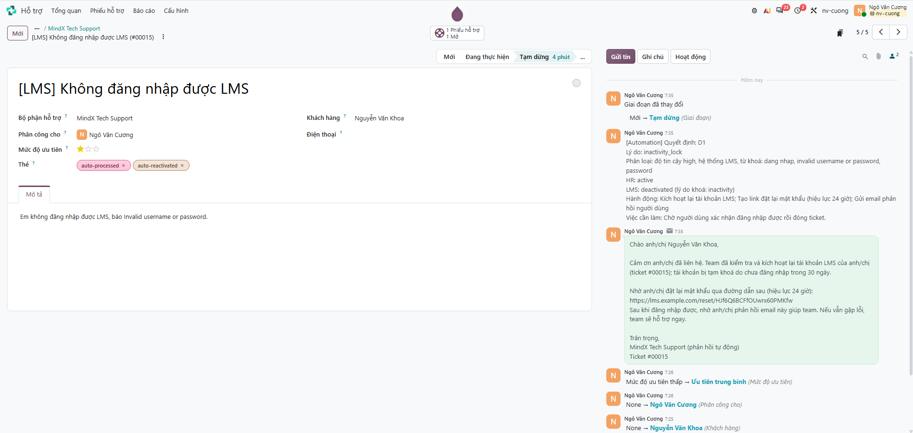
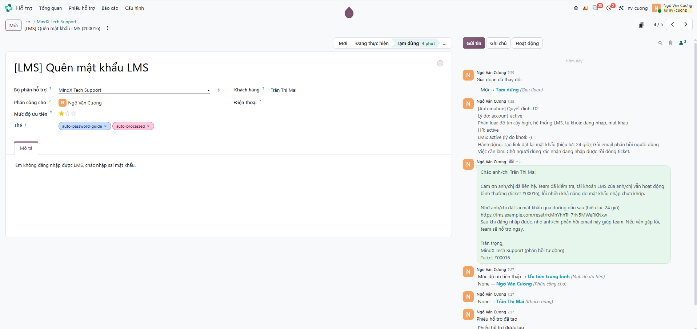
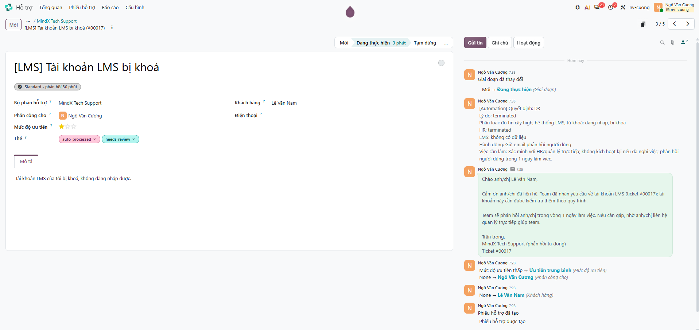
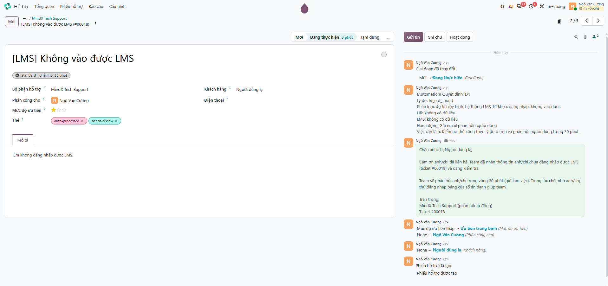
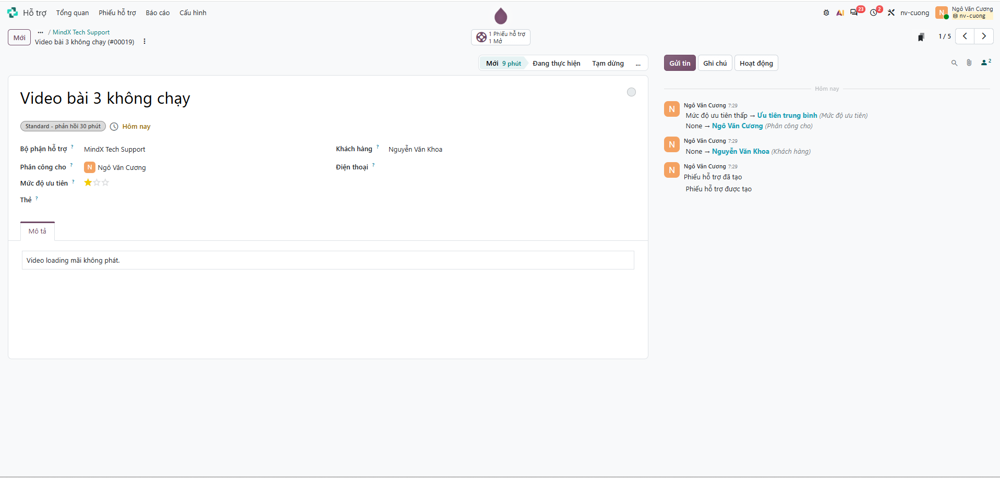
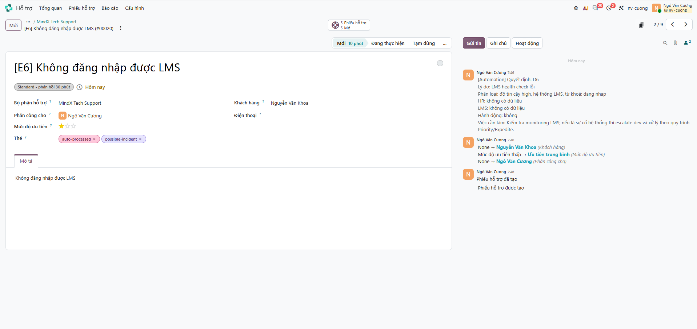
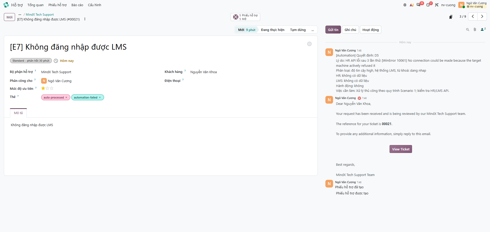
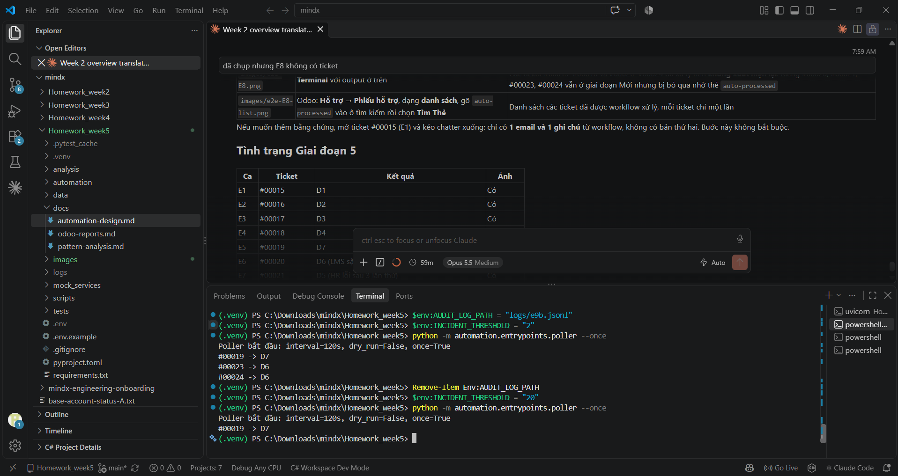
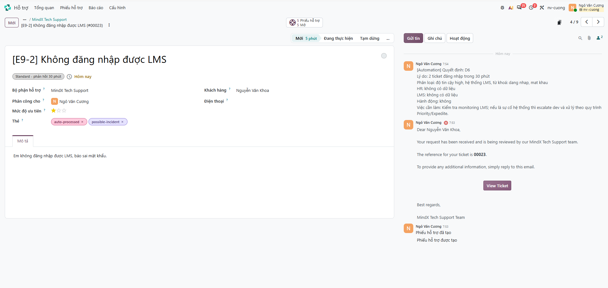

# Bằng chứng kiểm thử

Giai đoạn 5 của Week 5: kiểm thử workflow tự động hoá ticket đăng nhập ở hai mức – **tự động (pytest)** và **end-to-end trên Odoo thật** (`nv-cuong.odoo.com`, Odoo 20, đội MindX Tech Support) với mock HR/LMS.

## 1. Kiểm thử tự động (TDD)

Viết theo chu trình RED → GREEN → REFACTOR, mỗi bước một commit:

| Commit | Bước | Kết quả |
|---|---|---|
| `test(automation): add failing tests ...` | RED – chỉ viết test + khung `NotImplementedError` | 116 failed, 12 errors |
| `feat(automation): implement ...` | GREEN – code tối thiểu | 128 passed |
| `refactor(automation): ...` | REFACTOR – tách retry, tách bước xử lý | 128 passed (không đổi hành vi) |
| Các commit `fix(...)`, `feat(...)` sau E2E | Lỗi phát hiện khi chạy thật và lệnh chạy webhook – mỗi thay đổi: test fail trước → sửa | **136 passed** |

```
pytest -o addopts="" -q
136 passed
```

| Nhóm test | Nội dung chính |
|---|---|
| Domain | Phân loại (tiêu đề thật từ `sample.xlsx`), bảng quyết định D1–D7, mẫu email/ghi chú |
| Application | Chuỗi hành động từng nhánh với adapter giả, thứ tự LMS trước Odoo, dry-run, không xử lý trùng, guard sự cố |
| Adapters | Odoo JSON-2 (header, domain, `body_is_html`, `context.lang`), HR/LMS (retry, timeout, 404), audit log (che email) |
| Entrypoints, mock | Poller (`--once`, vòng lặp chịu lỗi), webhook (token), mock HR/LMS (khoá sau 30 ngày) |

## 2. Lỗi tìm ra nhờ chạy thật

| Lỗi | Phát hiện ở | Sửa |
|---|---|---|
| Email Odoo dồn thành 1 dòng | Spike ghi thử (Bước 0) | Gửi HTML (`<br>`) kèm `body_is_html` |
| Lượt dry-run bị đếm vào ngưỡng sự cố D6 | Khi lên kịch bản E2E | Bỏ sự kiện dry-run khi đếm |
| Poller không thấy ticket nào: API trả tên giai đoạn tiếng Anh (`New`), code tìm `Mới` | Chạy E2E lần đầu | Gửi `context: {lang: vi_VN}` trong mọi request (`ODOO_LANG`) |
| Ticket thứ 2 cùng lượt bị đếm 2 lần ("3 ticket" thay vì 2) | E9 | Đếm log 1 lần trước mỗi lượt |
| Ghi chú liệt kê từ khoá trùng ý (`password` trong `invalid username or password`) | E1 | Bỏ từ khoá nằm trong từ khoá dài hơn |

## 3. Kiểm thử end-to-end trên Odoo

**Môi trường:** Odoo 20 (JSON-2 API, API key phạm vi RPC) · mock HR + LMS (`uvicorn mock_services.app:app --port 8001`) · poller `python -m automation.entrypoints.poller --once`. Dữ liệu HR/LMS mẫu: [`mock_services/data/seed.json`](../mock_services/data/seed.json) (email `@example.com`).

| Ca | Ticket | Tình huống | Kỳ vọng | Thực tế | Kết quả |
|---|---|---|---|---|---|
| E1 | #00015 | GV đang làm việc, LMS khoá do 30 ngày không đăng nhập | D1 | D1 – kích hoạt lại, email kèm link, thẻ `auto-reactivated`, **Tạm dừng** | Đạt |
| E2 | #00016 | GV đang làm việc, LMS đang hoạt động | D2 | D2 – email link đặt lại mật khẩu, không kích hoạt lại, **Tạm dừng** | Đạt |
| E3 | #00017 | Nhân sự đã nghỉ việc | D3 | D3 – không kích hoạt lại; email trung tính, không nhắc nghỉ việc; ghi chú nội bộ `HR: terminated`; `needs-review` | Đạt |
| E4 | #00018 | Email không có trong HR | D4 | D4 `hr_not_found` – email hẹn 30 phút, `needs-review` | Đạt |
| E5 | #00019 | Ticket video, không liên quan | D7 | D7 – không ghi gì lên Odoo | Đạt |
| E6 | #00020 | LMS health check lỗi (`/admin/health?down=true`) | D6 | D6 `LMS health check lỗi` – không email, `possible-incident`, giữ **Mới** | Đạt |
| E7 | #00021 | HR không kết nối được (port sai) | D5 | D5 `HR API lỗi sau 3 lần thử` – không email, `automation-failed`, giữ **Mới** | Đạt |
| E8 | – | Chạy lại poller | Không xử lý trùng | Chỉ còn `#00019 -> D7`; ticket đã có thẻ `auto-processed` không xuất hiện lại | Đạt |
| E9 | #00023, #00024 | 2 ticket đăng nhập cùng lượt, ngưỡng 2 | D6 cả 2 | D6 cả 2, lý do "ticket đăng nhập trong 30 phút" | Đạt |

### Ảnh chụp chatter

| | |
|---|---|
| E1 – D1 kích hoạt lại  | E2 – D2 hướng dẫn mật khẩu  |
| E3 – D3 đã nghỉ việc  | E4 – D4 không có trong HR  |
| E5 – D7 bỏ qua  | E6 – D6 LMS sập  |
| E7 – D5 HR lỗi  | E8 – chạy lại  |
| E9 – D6 nhiều ticket  | |

### Trích log (`logs/automation.jsonl`, email đã che)

```
07:37:41 00015 D1 inactivity_lock      | Kích hoạt lại tài khoản LMS; Tạo link đặt lại mật khẩu; Gửi email phản hồi
07:37:43 00016 D2 account_active       | Tạo link đặt lại mật khẩu; Gửi email phản hồi
07:37:46 00017 D3 terminated           | Gửi email phản hồi
07:37:49 00018 D4 hr_not_found         | Gửi email phản hồi
07:49:12 00020 D6 LMS health check lỗi |
07:51:01 00021 D5 HR API lỗi sau 3 lần thử: [WinError 10061] ... |
07:56:30 00023 D6 2 ticket đăng nhập trong 30 phút |
```

## 4. Trước / sau

| Chỉ số | Thủ công (Week 4) | Tự động (Week 5) |
|---|---|---|
| Thời gian xử lý một ticket đăng nhập | 10–16 phút khi làm liền mạch; có ca 23,6 giờ (#00001, phản hồi trễ) | ~2–3 giây mỗi ticket (theo log) + tối đa 1 chu kỳ quét (2 phút) |
| Thao tác của support | Tra HR, tra LMS, kích hoạt, tạo link, viết email, ghi chú, đổi thẻ/giai đoạn | 0 với D1/D2; đọc ghi chú có sẵn với D3–D6 |
| Tỉ lệ tự động xử lý (E2E, ticket đăng nhập LMS hợp lệ E1–E4) | 0% | 2/4 hoàn tất tự động (D1, D2); 2/4 chuyển người kèm phản hồi ngay (D3, D4) |
| Tuân thủ SLA phản hồi 30 phút (Standard) | Phụ thuộc người trực | Luôn đạt (phản hồi trong chu kỳ quét) |

## 5. Giới hạn đã biết

- HR và LMS là **mock** – API thật cần cấu hình URL/xác thực tương ứng (`HR_API_URL`, `LMS_API_URL`).
- Email tới `@example.com` không gửi được thật (dấu đỏ trên Odoo) – nội dung và người nhận đã kiểm tra trong chatter.
- Trigger là **quét định kỳ** (module Quy tắc tự động hoá chưa cài); `webhook_server.py` đã có test nhưng chưa chạy với Odoo.
